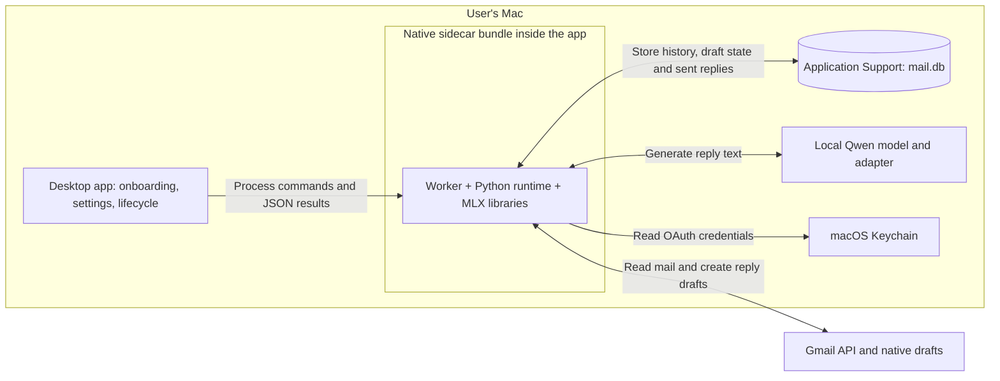

# Gmail reply draft architecture

Build a local Python worker that imports Gmail history once, checks for changes every **30 minutes**, generates replies with the local model, and saves them as real Gmail drafts. The person edits and sends from Gmail. On the next sync, the worker records the sent reply and associates it with the generated draft by **account and Gmail thread ID**.

This is the architecture for the automated reply component, packaged as a native sidecar for a **macOS desktop application first**. The desktop app owns onboarding, settings, model installation and process supervision. Gmail remains the reply editing and sending interface. Training consumes local data separately; a public HTTP server and push notification infrastructure are not required for this component.

## Components

The worker and model run in one process, separate from the desktop UI. The sidecar includes its interpreter and libraries so end users do not need a Python installation. SQLite also holds pending work, so a separate job broker is unnecessary. Model weights, mailbox data and adapters live outside the application bundle; tokens remain in Keychain. The native bundle preserves direct Metal and Keychain access. Build and application integration details are in [DESKTOP_PACKAGING.md](DESKTOP_PACKAGING.md).

| Module | Responsibility |
| --- | --- |
| `gmail_agent/auth.py` | Desktop OAuth login, refresh, disconnect, and Keychain storage. |
| `gmail_agent/client.py` | Gmail API operations, pagination, MIME decoding and reply construction. |
| `gmail_agent/store.py` | SQLite schema, transactions, sync cursors, draft state and thread lookups. |
| `gmail_agent/sync.py` | Historical import and periodic updates to messages, threads, labels and drafts. |
| `gmail_agent/replies.py` | Candidate selection, thread-based sent-reply matching, local generation and draft publication. |
| `gmail_agent/worker.py` | Startup, the 30-minute schedule, a single-instance lock and recovery. |
| `gmail_agent/service.py` | Install, start, stop, inspect and remove the per-user macOS login service. |
| `gmail_agent/runtime.py` | App data paths, interface version discovery and mailbox-free runtime diagnostics. |
| `packaging/macos/`, `scripts/build_macos.sh` | Build the relocatable Apple Silicon sidecar and distributable archive. |
| `gmail_agent/__main__.py` | Local commands to connect, import, run one cycle, run continuously, and inspect status. |

These modules are implemented. Generation reuses `train.draft.draft()` with a `Conversation` of ordered `me`/`them` messages when the training branch is present (and a narrow `Pair` fallback until it lands), loads one configured model and adapter lazily, and generates one reply at a time. Each cycle releases the model, Metal cache, and model lock before sleeping. The worker and training entrypoints share an absolute model lock, including across development and bundled processes; training can run between cycles, and a busy model defers queued work without consuming generation retries. The next cycle loads the latest weights. Follow [GMAIL_SETUP.md](GMAIL_SETUP.md) to enable the API, connect, and run the worker.

## Gmail connection

Create a Google Cloud project, enable Gmail API, configure the OAuth consent screen and development test users, and register a Desktop OAuth client. Use the system browser, PKCE, and a loopback callback for login. Keep refresh tokens in macOS Keychain; SQLite stores the account identity and a credential reference.

Request `gmail.readonly` for history and sent mail, plus `gmail.compose` for draft creation. Both are restricted scopes; public distribution requires the applicable OAuth verification. `gmail.compose` also grants sending capability, but this application only creates drafts and leaves sending to the person. See [Google's scope definitions](https://developers.google.com/workspace/gmail/api/auth/scopes) and [Desktop OAuth flow](https://developers.google.com/identity/protocols/oauth2/native-app).

## Historical import and scheduling

**First connection:** record an activation time. At the start of import, capture a Gmail history cursor, then import existing received and sent messages in resumable pages over the selected history range. Fetch full thread context; preserve Gmail IDs, RFC message headers, participants, timestamps and decoded body text. Cleaning and masking are separate planned pipeline steps.

Historical import supplies data for the planned training pipeline. It does not automatically enqueue drafts for the archive. Automatic drafting starts with eligible incoming messages after activation. Explicitly queueing older unanswered threads is a future extension.

After backfill, replay changes from the starting cursor to include activity that occurred during the import. Upserts make overlap harmless. Record the resulting cursor only after the changes and resulting pending work are durable.

**Normal operation:** run a catch-up cycle at startup, then start a cycle every 30 minutes while the worker is running. A per-account process lock prevents overlapping instances for the same account; a long cycle delays the next one rather than starting another. The macOS user LaunchAgent starts the worker after login and restarts it if the process exits. An on-demand command uses the same cycle implementation. Stop the account’s service before running manual cycles. OAuth reconnect requires stopping all workers sharing the database.

The interval is configurable, with `sync_interval_seconds = 1800` as the default. A new email normally gets a draft within one interval plus processing time. Sleep, lack of connectivity, and a generation backlog extend that delay; resume from the saved cursor when the Mac is available.

Use `history.list` for incremental changes and fetch each affected thread once per cycle. Include newly added messages, sent messages, label changes and deletions; sent detection must inspect labels on new messages as well as label-add events. If Gmail rejects an expired cursor with HTTP 404, rebuild the mailbox snapshot while retaining existing generation records. [Gmail synchronization guide](https://developers.google.com/workspace/gmail/api/guides/sync)

## Each 30-minute cycle

1. **Sync changed threads.** Upsert messages and refresh the Gmail draft index once per cycle, grouped by thread. Refetch threads affected by history, active generated drafts, or changed draft-ID sets; unchanged unrelated human drafts need no full-thread fetch. Keep all changes account-scoped.
2. **Reconcile sent replies first.** Close active draft records when their thread has a newly sent reply. Record deleted or discarded drafts separately.
3. **Queue eligible reply turns.** For an inbox thread, consider its newest non-draft message. Queue it only when that message is incoming, the thread has not already been answered, and there is no existing Gmail draft or active local generation. Apply the project's automated-mail filters. Read/unread status does not determine eligibility.
4. **Commit the cursor and pending work.** Advance the history cursor in the same transaction that makes the corresponding local changes and queued reply work durable. A later model failure must not lose an incoming message or require replaying the mailbox import.
5. **Generate locally.** Resolve the recipient from `Reply-To` or `From`, snapshot the last three messages with their `me`/`them` roles, including the triggering incoming message, and save the original generated text, context snapshot, model and adapter version. The initial behavior is a direct reply; reply-all is a separate feature.
6. **Recheck and publish.** Refetch the candidate thread and check for a new reply, newer incoming message, or an existing draft before writing. If the conversation changed during generation, supersede the queued turn and reevaluate the current thread. Otherwise, create the Gmail reply draft and persist its returned draft ID.

The MVP candidate filter excludes spam, trash, self-sent messages, bulk mail and automated notifications. It is not a learned triage classifier; a qualifying human message can receive a suggestion even when no reply is strictly necessary. Later triage can refine candidate selection without changing the sync or publishing architecture.

Own draft creation also appears in subsequent history updates. Excluding `DRAFT` messages from incoming-message selection prevents a generation loop.

## Draft creation and ownership

Create a MIME reply with the recipient, matching subject, `In-Reply-To` and `References` headers. Send its base64url encoding to `drafts.create` with the existing Gmail `threadId`. This makes it a native draft attached to that conversation. [Gmail threading requirements](https://developers.google.com/workspace/gmail/api/guides/threads)

**Once published, the draft belongs to the person.** Scheduled runs do not rewrite its text or replace an existing human draft. If another incoming message arrives while a draft exists, leave that draft intact and record that the conversation has moved on. If the person discards a draft, do not recreate it for the same incoming message on the next cycle; a later incoming message can start a new reply turn.

Persist a `publishing` state before calling Gmail. A timeout or crash can leave the remote outcome unknown because Gmail creation and the local commit are not atomic. On recovery, inspect drafts and sent messages in that thread before taking any further action. An unresolved publishing attempt blocks another creation for that thread and is reported by the status command; do not blindly retry it. Ordinary read failures can retry with backoff. This is best-effort duplicate prevention, not a claim of exactly-once delivery.

A final preflight check reduces races with Gmail editing, but the API does not provide an atomic "create only if this thread still has no draft" operation. Any conflicting draft discovered afterward is left intact for the person to resolve.

## Thread-based feedback mapping

The mapping key is `(account_id, gmail_thread_id)`. Permit **at most one active generated draft per thread**. Use the incoming message ID to distinguish successive reply turns inside that thread, not to perform cross-thread attribution.

For each confirmed published draft, require its Gmail draft ID to be absent and no surviving draft messages in the refreshed thread before linking the earliest newly observed `SENT` message after publication. If a separate reply appears while a draft survives, or publication was never confirmed, supersede the generation without exporting feedback. Retain surviving remote drafts because they may contain human edits; status asks the person to inspect them. Discarding such a draft later does not retroactively create feedback. Additional sent messages remain ordinary sent history. A subsequent incoming message can create a new generation in the same thread.

This remains a **thread-level correspondence**, not proof of draft provenance: discarding a draft and composing a separate reply between polls is ambiguous. The disappearance check excludes replies observed while the original draft remains, without requiring fuzzy text similarity that could reject substantial human edits.

Gmail removes the draft when it is sent and creates a sent message with a new ID, so draft IDs cannot serve as sent-message IDs. A missing draft without a corresponding sent reply is a dismissal, not a completed reply or a preference-training example. [Gmail draft lifecycle](https://developers.google.com/workspace/gmail/api/guides/drafts)

Preserve the generated text, its original context, the final sent text, and whether the text changed. Compare LF/CRLF/CR line endings equivalently, while preserving meaningful internal spaces and blank lines. Uncertain publication recovery uses the same comparison rule. `export-feedback` emits the trainer’s `Edit` fields (`adapter_name`, `conversation`, `draft`, `final`, and `type`) alongside the existing raw audit fields. `draft` and `final` use normalized line endings so the trainer’s own comparison does not invent preferences; the raw generation and sent body are retained as `generated_text` and `final_text`. The training branch applies its masking pipeline; unchanged text does not produce a chosen/rejected preference pair. Historical and unassisted sent messages remain available for supervised training independently of generated-draft mappings.

## Minimal data model

Use the existing planned `data/mail.db`. Store Gmail message IDs separately from RFC `Message-ID` headers, and store history IDs as opaque strings.

| Table | Important fields and constraints |
| --- | --- |
| `accounts` | `account_id`, email, credential reference, activation time, history cursor, backfill progress, last successful sync. |
| `threads` | `(account_id, thread_id)` primary key; subject and current draft IDs. |
| `messages` | `(account_id, message_id)` primary key; thread ID, labels, Gmail timestamp, sender/recipients, reply headers, decoded body text, deletion/snapshot state, and a reserved cleaned-body field. Direction is derived from labels and sender. |
| `reply_drafts` | Local ID, account/thread IDs, trigger message ID, context snapshot, generated text, model/adapter version, Gmail draft ID, state, publication time, sent message ID, last error. |
| `worker_health` | Account-scoped cycle state, last attempt, last completed cycle and sanitized error class. Preserved across process restarts. |

Keep final sent text in `messages`, linked from `reply_drafts`; the export joins it with the immutable generated text. This avoids a separate feedback table for the MVP.

Enforce a unique `(account_id, thread_id, trigger_message_id)` in `reply_drafts`, plus a partial unique index on `(account_id, thread_id)` for active states. Terminal records remain stored to prevent recreating dismissed or completed turns.

Draft states are `queued`, `ready`, `publishing`, `published`, `sent`, `dismissed`, `superseded`, and `failed`. The first four are active. The usual path is `queued → ready → publishing → published → sent`. An uncertain external write stays `publishing` until reconciled; a failure known to have happened before publication can be retried using its existing record.

## Operational boundaries

Email processing, model inference, training data, and adapters stay on the Mac. Native drafts are uploaded to Google and edited there. Keep message bodies and OAuth tokens out of operational logs; report sync times, processed counts, queued drafts and per-thread errors instead.

The model can still emit placeholders, which the person resolves in Gmail. This component does not enforce Gmail's native Send action across browsers and phones. The earlier plan's universal placeholder send-blocking requirement therefore needs a separate UI mechanism if it remains a product requirement; it is not part of this automated draft worker.

The command surface is `info`, `self-check`, `connect`, `disconnect`, `backfill`, `once`, `run`, `status`, `service`, `recover`, and `export-feedback`. During development use `python -m gmail_agent`; the shipped app invokes `lahacks-mail-worker` directly. Finite operations return JSON on stdout, while logs go to stderr. The app reads `info` to check the interface version and paths, supervises a long-running `run` process, and reads `status` in a separate process. No permanent local port is needed.

Alternatively, `service` manages one LaunchAgent per connected account and macOS user. It stores no credentials in the plist, resolves configured paths at installation, and launches either the bundled executable or the development virtualenv as appropriate. Choose one supervisor per account; do not run its login service and an app-owned worker concurrently. Different accounts can share the database and serialize model use through the model lock. Service commands require `--account` when multiple jobs are installed; legacy single-job installations remain controllable until explicitly reinstalled. Inference is offline; Gmail traffic remains authenticated HTTPS. Keep the executable or development environment at its configured path while the login service is installed.

The bundled default home is `~/Library/Application Support/lahacksai26`; an absolute `LAHACKS_MAIL_HOME` overrides it. Application updates replace the sidecar without replacing mail data, models, adapters or Keychain entries. Existing development data is reused only through explicit paths or a controlled migration. The app's release pipeline is responsible for signing, notarization and integration testing on its supported macOS versions; the generated archive is initially ad hoc signed for local testing.

`status` reads persisted mailbox and cycle health without OAuth. `service status` inspects the actual launchd job, including PID and exit state. A persisted `running` cycle alone does not prove the process is alive; use both commands. Logs contain counts and error classes, not email text or OAuth callback URLs.

## Build order and completion criteria

1. **Connect and store:** OAuth, Keychain, SQLite schema and resumable historical import. Repeating import does not duplicate messages.
2. **Sync on schedule:** saved-cursor incremental sync, startup catch-up and the 30-minute loop. Replay, expired cursors and restarts preserve pending reply work.
3. **Publish native replies:** reuse the existing local model, select eligible threads and create correctly threaded Gmail drafts. Repeated cycles preserve human drafts and do not recreate handled reply turns.
4. **Capture final replies:** the person edits and sends in Gmail; the following cycle links the sent text to the active generation by thread. Discarded drafts do not become sent examples.

The integration is complete when a new eligible email produces a native Gmail reply draft, the person sends their edited version, and the next scheduled cycle records both texts under the same local thread without producing a duplicate draft.

The owner explicitly skipped that live email exercise during setup. OAuth connection, full historical import, incremental sync, and local model generation have been verified separately; the draft/edit/send lifecycle and failure cases have automated coverage. Live Gmail publication and human-send feedback remain unverified, rather than being represented as a completed live test. See the verification record in [GMAIL_SETUP.md](GMAIL_SETUP.md).
